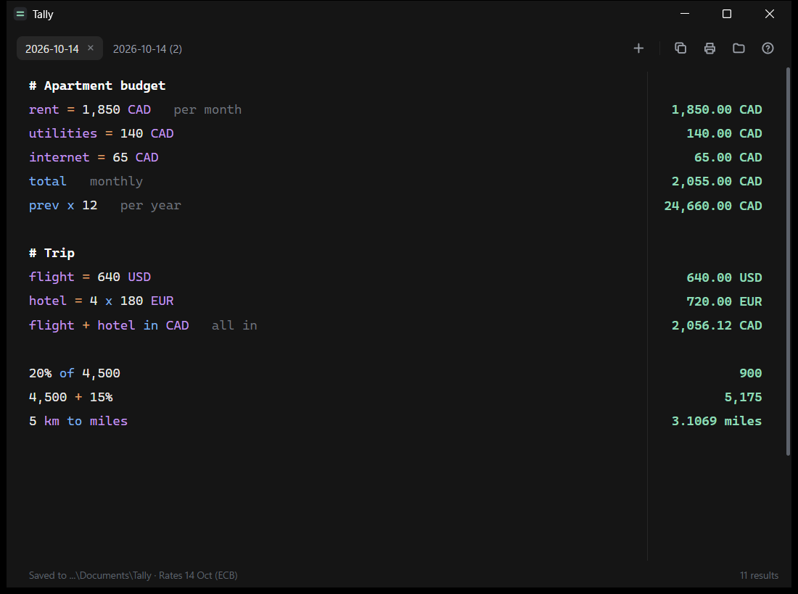

# Tally

A small calculator notepad for Windows. Write a calculation on each line, add a note after it in plain words, and the answer appears on the right. Keep as many sheets as you like in tabs, and print any of them.

Inspired by [Numi](https://numi.app), with the things I missed on Windows: tabs that are saved, printing, and sheets stored as plain text files you own.



## Download

Get the installer from the [Releases](../../releases) page:

| Your PC | File |
|---|---|
| Intel or AMD (most Windows PCs) | `Tally-Setup-x64.exe` |
| ARM, such as Snapdragon laptops | `Tally-Setup-arm64.exe` |

Run it once. Tally installs for your Windows account only (no administrator prompt) into `%LOCALAPPDATA%\Programs\Tally`, adds itself to the Start menu, makes `.note` files open in Tally, and appears in Settings > Apps, where you can uninstall it. Uninstalling never touches your sheets. Windows 10 and 11 already include the Edge WebView2 runtime it uses.

Tally keeps itself up to date. It checks for a new release when it starts and every 12 hours, downloads the build for your PC, checks it against the SHA-256 that GitHub publishes for that file, and shows "Tally x.y.z is ready. Restart" at the bottom of the window. Click it, or just open Tally again later.

Prefer no installer? `Tally-x64.exe` and `Tally-arm64.exe` run from anywhere, and update themselves the same way if their folder is writable.

The builds are not code-signed, so the first time you run one Windows SmartScreen may show "Windows protected your PC". Click "More info", then "Run anyway".

## What you can type

| Line | What it does |
|---|---|
| `28 x 1,950 x 12   gross rent` | words after the maths are a note |
| `rent = 1,850` | names a result so later lines can use `rent` |
| `prev` | the previous answer (or press Tab to insert it) |
| `total` | adds up the answers above, back to the last blank line or heading |
| `20% of 4,500` | percentages; also `4,500 + 15%`, `15% off 200`, `15% on 200`, `30 as % of 120` |
| `5k`, `2.5M` | thousands and millions |
| `5 km to miles` | units: length, area, volume, weight, time, temperature and more |
| `100 USD to CAD` | currencies; also `€50 in CAD` and `2,500 CAD + 300 USD` |
| `# Heading` | a section title, which also starts a new `total` |
| `// comment` | ignored |

Commas in numbers are fine. `$` on its own is treated as a plain number, since it can mean more than one currency; write the code (`USD`, `CAD`) when it matters. Click any answer to copy it.

If a line uses a name you have not defined yet, such as `occ * prev` before `occ = 95%`, the name is underlined and the answer column shows `? occ` instead of staying blank. A word straight after a number (`15% tip`) is still just a note.

## Suggestions as you type

When the cursor is at the end of a line, Tally shows a faint guess at what comes next. Press Tab or the right arrow to take it, Esc to hide it, or just keep typing.

- The rest of a line you have written before: type `need = price *` and it offers `6.25%   NOI needed at a six and a quarter cap` from an earlier sheet. If a start was finished more than one way, the most common ending wins.
- The rest of a name you defined (`ar` gives `area`), a Tally word, unit or currency (`sq` gives `sqft`, `US` gives `USD`), or a word you have used before.
- The rest of a number you have used before: `4,9` gives `4,975,000`.

Suggestions come from the open sheet and, unless you switch it off in the help panel (the ? button), the other sheets in the same folder. Nothing is sent anywhere. With no suggestion showing, Tab still inserts the previous answer.

## Sheets and tabs

- New sheets are named by date, `2026-10-14`, then `2026-10-14 (2)` for a second one that day. Double-click a tab to rename it; hover to see when it was created.
- Drag a tab to move it, or press Ctrl+Shift+PgUp / PgDn to move the open one. Tabs reopen in the order you left them.
- Each sheet is a plain text file in `Documents\Tally`, so you can back them up, sync the folder, or open them in any editor. New sheets are `.note` files, which open in Tally when you double-click them; `.txt` files in the folder show up as sheets too. Set `TALLY_DIR` to keep them somewhere else.
- Opening a `.note` file (or a `.txt` with Open with > Tally) opens the folder it is in, with every sheet there as a tab, and shows that one. If Tally is already open, that window switches to it.
- Tally shows one folder of sheets at a time. Click the folder button to switch between recent folders, or choose another one (Ctrl+O), such as a folder per deal or per month. The picker can also make a new folder. Tally reopens on the folder you used last.
- Closing a tab moves its file to a `Trash` folder inside the sheets folder. Nothing is deleted.
- Print / PDF prints the current sheet as a clean two-column page.
- A long line scrolls sideways under the answers, which always stay at the right edge of the window.
- The window reopens where you left it, at the same size, unless that spot was on a monitor that is no longer connected; then it opens centred. Launching Tally while it is already open brings the open window forward instead of starting a second copy.

| Shortcut | Action |
|---|---|
| Ctrl+T | new sheet |
| Ctrl+W | close sheet |
| Ctrl+Tab, Ctrl+1..9 | switch sheets |
| Ctrl+Shift+PgUp / PgDn | move the open sheet left or right |
| Ctrl+P | print or save as PDF |
| Ctrl+O | choose the sheets folder |

## Currency rates

Rates are the European Central Bank reference rates (about 30 currencies) from [frankfurter.dev](https://frankfurter.dev). Tally fetches them in the background at most every 12 hours and keeps the last set in `%LOCALAPPDATA%\Tally\rates.json`, so conversions still work offline. The status line shows the date of the rates in use. They are reference rates, published once each working day, not the rate your bank will give you.

That rate request and the update check (to api.github.com, then the download from GitHub) are the only things Tally sends over the network. Your sheets never leave your PC.

## Build from source

Needs Go 1.27 or later and Node.js (for the engine tests).

```
node test_engine.js
node test_predict.js
go test ./...
go build -ldflags "-H windowsgui -s -w" -o Tally.exe .
```

Set `GOARCH=amd64` or `GOARCH=arm64` to build for the other architecture. The icon is drawn by `go run ./tools/mkicon` and embedded with `go run github.com/akavel/rsrc@v0.10.2 -ico tally.ico -arch <arch> -o rsrc_windows_<arch>.syso`; the generated `.syso` files are committed, so you only need this when changing the icon.

How it fits together:

- `main.go` opens a native window with WebView2, serves the page from the embedded `web/` folder, and reads and writes the sheet files.
- `folder.go` keeps the folder in use and the recent list, and opens the Windows folder picker.
- `open.go` opens a sheet file from Explorer, handing it to the open window if there is one.
- `install.go` is the installer: the same program run as `Tally-Setup-*.exe` (or with `--install`) installs itself; `--uninstall` removes it.
- `update.go` checks GitHub releases and swaps in a verified newer build.

Releases: push a tag such as `v1.3.0` with the release notes as its message (`git tag -a v1.3.0 -m "..."`). CI builds both architectures with that version stamped in and publishes the installers, the plain builds and their checksums. Installed copies pick it up on their next check. Local builds are `dev` and never update.
- `web/engine.js` turns a sheet into one answer per line, on top of [math.js](https://mathjs.org).
- `web/predict.js` works out the suggestion to show after the cursor.
- `web/app.js` and `web/index.html` are the editor, tabs, copying and printing.

## Licence

MIT, see [LICENSE](LICENSE). math.js is bundled under the Apache License 2.0; see [NOTICE](NOTICE).
